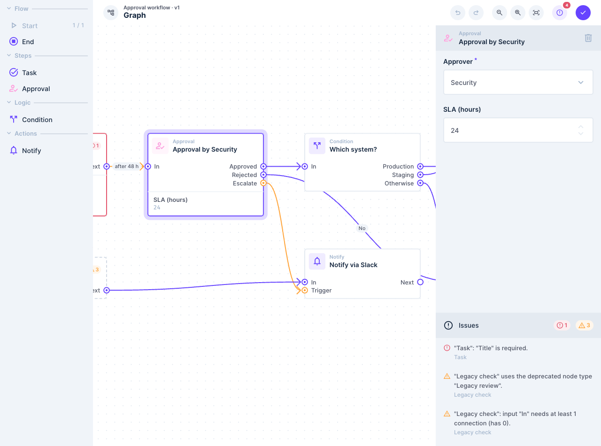
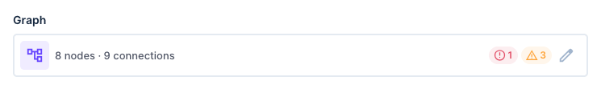
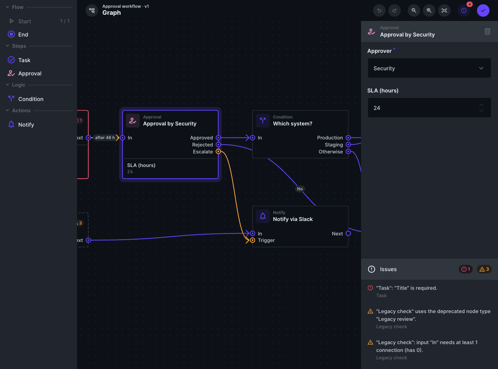

# directus-extension-node-graph


A node-graph field for [Directus](https://directus.io). It stores a graph of nodes and connections in a JSON field and edits it in a widened side drawer that looks like part of the Data Studio: Flows-style cards and arrows, the dotted Flows grid, and Directus components and theme tokens throughout. What a graph may contain is set per field with a JSON ruleset, which the editor checks while you draw and the server checks when the item is saved.



## Features

- **One bundle, three parts.** The **Node Graph** interface (`node-graph`), the **Node Graph Summary** display (`node-graph-summary`) and a hook (`node-graph-guard`) that validates graphs on the server.
- **An editor in the stock drawer.** Node types in the drawer's sidebar (drag one onto the canvas or click it), the graph in the middle, and the selected node's or connection's fields in a Directus form on the right, above the list of issues. Undo and redo, zoom and fit to screen, snap to grid, an optional minimap, box selection and keyboard moves. Drawn with [Vue Flow](https://vueflow.dev).
- **Rules as data.** A ruleset declares node types (icon, colour, palette category, fields, inputs and outputs, instance limits, deprecation), outputs generated from a repeater field, data types and which of them connect, connection types (path style, colour, dashes, label template, fields), connection rules (type checks, self loops, cycles, duplicate connections, allowed or denied pairs), graph rules (entry nodes, reachability, size limits), per-rule severities and the graph that "Create" starts from. No code, expressions or regular expressions.
- **Checked while you draw.** Ports a connection may not end on are dimmed while it is drawn, and releasing on one says why. Everything that is still wrong is listed in the issues panel, errors first, and clicking an issue takes you to the element.
- **One rules engine everywhere.** The editor, the field row, the display and the server use the same code, so they always agree.
- **Server-side enforcement** for every write that goes through the item service (app, REST, GraphQL, imports, flows), with a **Ratchet** policy that accepts old errors but refuses new ones. A ruleset that does not compile cannot be saved.
- **Looks like Directus** in light, dark and custom themes. No graph library theme is loaded.
- **Nothing is lost.** Unknown node types, ports and keys in a stored graph are kept and shown, malformed values are repaired rather than dropped, and the stamps content versioning adds are removed.
- **Self-contained.** The app bundle imports only `vue` and `@directus/extensions-sdk` from Directus; Vue Flow is bundled.

## Installation

Choose one:

- **npm.** In the project that runs Directus run `npm install directus-extension-node-graph`. Directus discovers extensions listed in the root `package.json` on startup.
- **Local folder.** Clone this repository into `<EXTENSIONS_PATH>/directus-extension-node-graph` (`EXTENSIONS_PATH` defaults to `./extensions`), run `npm install && npm run build`, then restart Directus. Only `package.json` and `dist/` are needed at run time, so a folder with just those two works too.

The Marketplace cannot install it under the default [`MARKETPLACE_TRUST`](https://directus.io/docs/configuration/extensions) of `sandbox`. With that setting Directus only lists and downloads app extensions and API extensions that run in the sandbox, and this bundle contains a hook that does not: to enforce the rules it reads `directus_fields` and the stored items through the database connection the event hands it, which sandboxed extensions do not get. An administrator who sets `MARKETPLACE_TRUST=all` lifts that restriction; otherwise use npm or a local folder.

## Usage

1. Restart Directus if you installed via npm or a local folder, and reload the Data Studio, which fetches extensions once when it starts.
2. Settings, Extensions: confirm **directus-extension-node-graph** is enabled, with its interface, display and hook.
3. Settings, Data Model, open a collection and create a field. Choose **Node Graph**, in the "Other" group. The field is stored as JSON.
4. In the field's interface options, put a ruleset into **Ruleset**. Click the code editor's template button to start from the example "Approval workflow", or paste one of the files in [`examples/`](examples). [`docs/ruleset.md`](docs/ruleset.md) describes the format. A ruleset with problems cannot be saved, and the error lists them.
5. Adjust the other options if you like (below), and under Display pick **Node Graph Summary**.
6. Save the field, open an item and click **Create** on the field row. The example ruleset starts with a Start and an End node: drag node types in from the left, connect an output to an input, edit a node in the inspector, then click the check button (or press ⌘⏎ / Ctrl+Enter) and save the item.



The editor stages the graph in the item form like the Repeater stages its items: nothing is written until the item is saved, and inside a nested drawer the outer drawer must be applied too. Read-only fields, and users without update permission, get a **View** button that opens the same editor read-only.

| Option | Default | Description |
|---|---|---|
| Ruleset | none | The JSON ruleset. Until one is set the field shows a notice instead of the row. |
| Summary Template | "3 nodes · 2 connections" | Text of the field row and of the display. Tokens: `{{nodeCount}}`, `{{edgeCount}}`, `{{errorCount}}`, `{{warningCount}}`, `{{counts.<type key>}}`, `{{ruleset.name}}`, `{{ruleset.version}}`. |
| Placeholder | "No graph yet" | Shown while the field is empty. |
| Editor Width | Wide | Standard (the stock drawer width), Wide (80% of the window) or Full. |
| Server Enforcement | Ratchet | Ratchet, Reject, Log only or Off. See [Server-side validation](#server-side-validation). |
| Snap to Grid | on | Nodes snap to the grid when moved. |
| Grid Size | 18 | In canvas units at 100% zoom, 4 to 96. 18 is the Flows grid. |
| Minimap | off | A minimap in the bottom right corner of the canvas. |

The **Node Graph Summary** display shows the field row's text in tables and display templates, with an error icon when the stored graph has errors. It reads the field's own ruleset and template, so it has no options of its own.



## Keyboard shortcuts

Inside the editor (⌘ on macOS, Ctrl elsewhere):

| Keys | Action |
|---|---|
| Delete or Backspace | Delete the selection (outside text fields) |
| ⌘Z | Undo |
| ⌘⇧Z or Ctrl+Y | Redo |
| ⌘S | Apply and keep the editor open |
| ⌘⏎ | Apply and close |
| Escape | Cancel a connection being drawn, then clear the selection, then close the editor (asking first if there are unapplied changes) |
| Shift + drag on the empty canvas | Select with a box |
| ⌘ + click | Add to the selection |
| Tab, then Enter or Space | Select the focused node or connection |
| Arrow keys | Move the selected nodes one grid step (1px, or 10px with Shift, when snapping is off) |

## Server-side validation

The hook checks every graph field written through Directus's item service, whichever way the write arrives: the app, REST, GraphQL, WebSockets, imports, flows with "Emit Events" on, revision reverts and version promotion. It validates the value against the field's current ruleset with the same engine as the editor, applies the field's **Server Enforcement** option, and stores the normalised graph with a freshly computed `meta` (node, connection, error and warning counts and a content hash).

- **Ratchet** (default): a new item must have no errors. An update is refused only when it adds an error the stored graph did not already have, so graphs with old errors stay editable.
- **Reject**: any error refuses the save.
- **Log only**: saves are never refused; graphs with errors or warnings are logged with their counts.
- **Off**: the field is not checked.

Warnings never refuse a save. A refused save fails with `FAILED_VALIDATION`: the item form marks the field as invalid and its error notice lists the offending issues, and API clients get the issue codes and element ids in the error's `extensions`. Saving a field whose ruleset does not compile is refused with the list of problems.

The hook does not see writes made with `emitEvents: false`, direct SQL, content-version drafts (their promotion is checked) or system collections. [`docs/ruleset.md`](docs/ruleset.md#server-side-enforcement) has the details.

## Compatibility

Built and tested against Directus 11.17.4. The `host` range starts at 11.15.0, the first release with the `nonEditable` state the field row uses to stay clickable when read-only, but only 11.17.4 has been tested. The editor has been tested in Chrome only, not yet in Safari or Firefox, and not inside a nested M2A item drawer.

The stock drawer has no width option, so the editor widens it, and fits its body under the drawer's own palette section below 54rem, with unscoped CSS rules keyed on the drawer's internal class names (`#dialog-outlet .v-drawer`, `.content > .main`). Re-check them when upgrading Directus. Directus 12 renames several theme variables; the CSS lists the new names as fallbacks, but has not been run against 12.

## Limitations

- Rulesets are edited as raw JSON in the code editor; there is no visual ruleset editor yet. Renaming a node type, port or field key in a ruleset does not migrate stored graphs: their elements are kept and reported as issues until someone fixes them.
- In the Wide drawer with the palette and the inspector open, the canvas is about 730px wide, so fit to screen shows a medium-sized graph at around 40% and the card text is small. Zoom in, or use the Full width.
- When the editor is narrower than 50rem (the Standard width, or any width on a narrow screen) the inspector and issues move under the canvas, and opening the "Node Types" section in a narrow drawer pushes the fitted graph partly out of view until you click fit.
- Outputs generated from a repeater field are keyed by position, so reordering the repeater's items moves their connections.
- Connections whose source or target node does not exist cannot be drawn. They are kept in the stored value and listed in the issues panel (`dangling_edge`), but you only see them there. If two nodes or connections share an id, only the first is drawn.
- Pressing Escape while dragging the end of a connection to another port ends the line at once, but Vue Flow keeps that connection hidden until the mouse button is released. Escape during a drag can also leave an undo step that changes nothing.
- Backward curved connections can loop behind the target card; the `step` path style routes around it.
- After Reload in the "This field changed while you were editing" banner, the zoom readout can show 100% until the view next changes.
- The header buttons' accessible names land on a wrapper rather than on the button itself.
- When the selection includes a node that cannot be deleted, the Delete key and the inspector disagree about what can be deleted.
- Under the field, a refused save shows only the generic "Value doesn't have the correct format"; the details are in the form's error notice.
- In the example ruleset, Event ports use the warning colour, the same orange as a port with a warning.
- The app bundle (`dist/app.js`) is about 405 KB, 123 KB gzipped, and like every app extension it is loaded on every Data Studio page. About 63 KB of it is CSS, which the extensions SDK embeds unminified, and the minimap package adds about 54 KB even when no field turns the minimap on.

## Development

```bash
npm install
npm run dev       # watch build, unminified
npm run check     # vue-tsc, then tsc over the tests
npm test          # vitest
npm run build
npm run validate
```

The code is laid out as follows:

- `src/interface.ts`, `src/display.ts` and `src/hook.ts` are the three bundle entries.
- `src/shared/core` is the framework-free rules engine: compiling rulesets, reading stored values, validation, the connection check, editor commands, templates and hashing. It runs in both the app and the API bundle, so it uses no Vue, DOM or Node APIs.
- `src/shared/ui` is the editor shell (field row, drawer, palette, inspector, issues, history, keyboard, apply and cancel) and `theme.css`. It knows nothing about Vue Flow.
- `src/canvas` is the Vue Flow canvas. It implements `src/shared/ui/canvas-contract.ts`, the only seam between the shell and the graph library.
- `src/shared/display` and `src/shared/hook` are the display and the server-side guard, and `src/shared/options.ts` the interface options.
- `tests` holds the unit tests of the core, the hook and the options, `examples` the example rulesets, and `docs` the [ruleset reference](docs/ruleset.md) and the [design spec](docs/design.md).

## Releasing

Nothing runs automatically. Two workflows under the Actions tab are triggered by hand:

- **Build** runs check, test, build and validate on Node 22, then attaches the exact `.tgz` that would be uploaded to npm as a downloadable artifact. Run it whenever you want to inspect what a release would contain.
- **Publish** takes a version number. Bump `version` in `package.json`, add a `CHANGELOG.md` entry, commit and push to `main`, then run the workflow with that version. It verifies the version matches `package.json`, publishes to npm with provenance via trusted publishing, and only after npm accepts the upload creates the `v*` tag and the GitHub Release using the changelog entry as notes. The job runs under the `publishing` environment, so it pauses for approval when that environment has required reviewers.

## License

[MIT](LICENSE)
